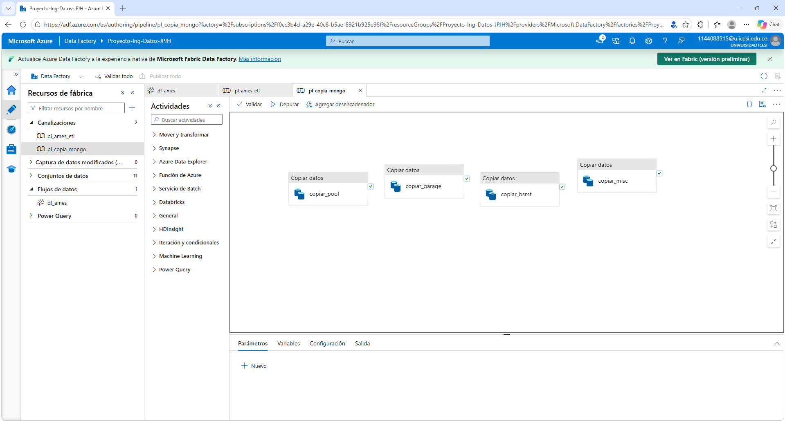
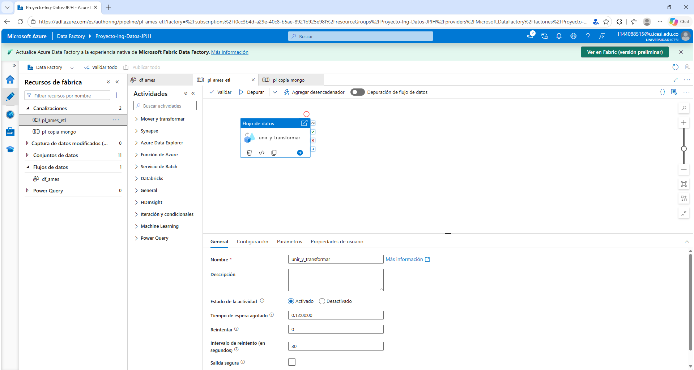
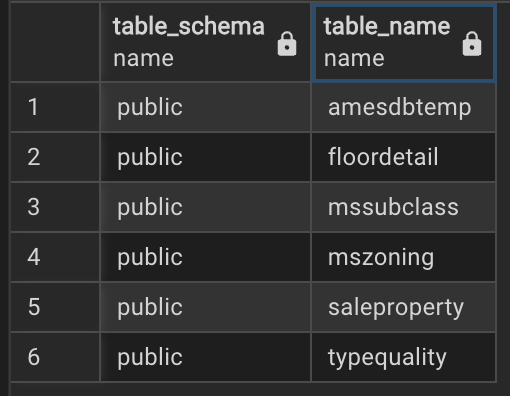
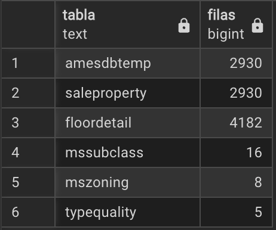
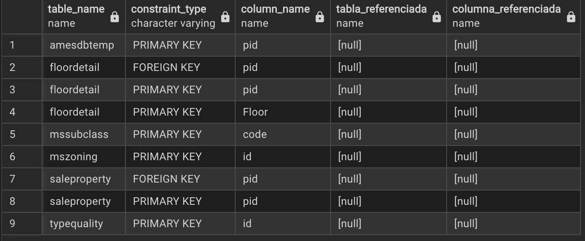
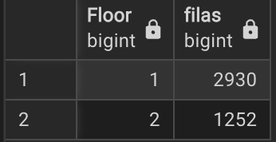
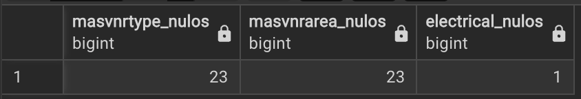
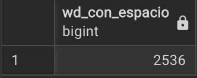
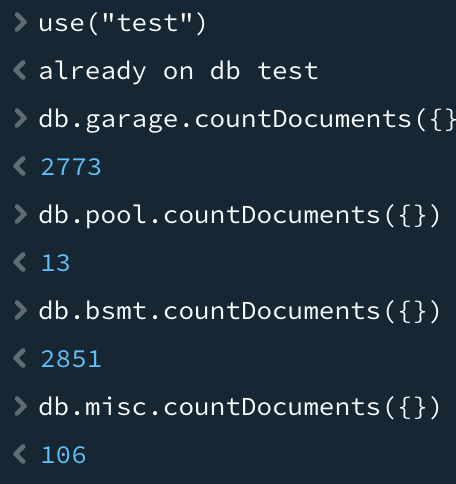
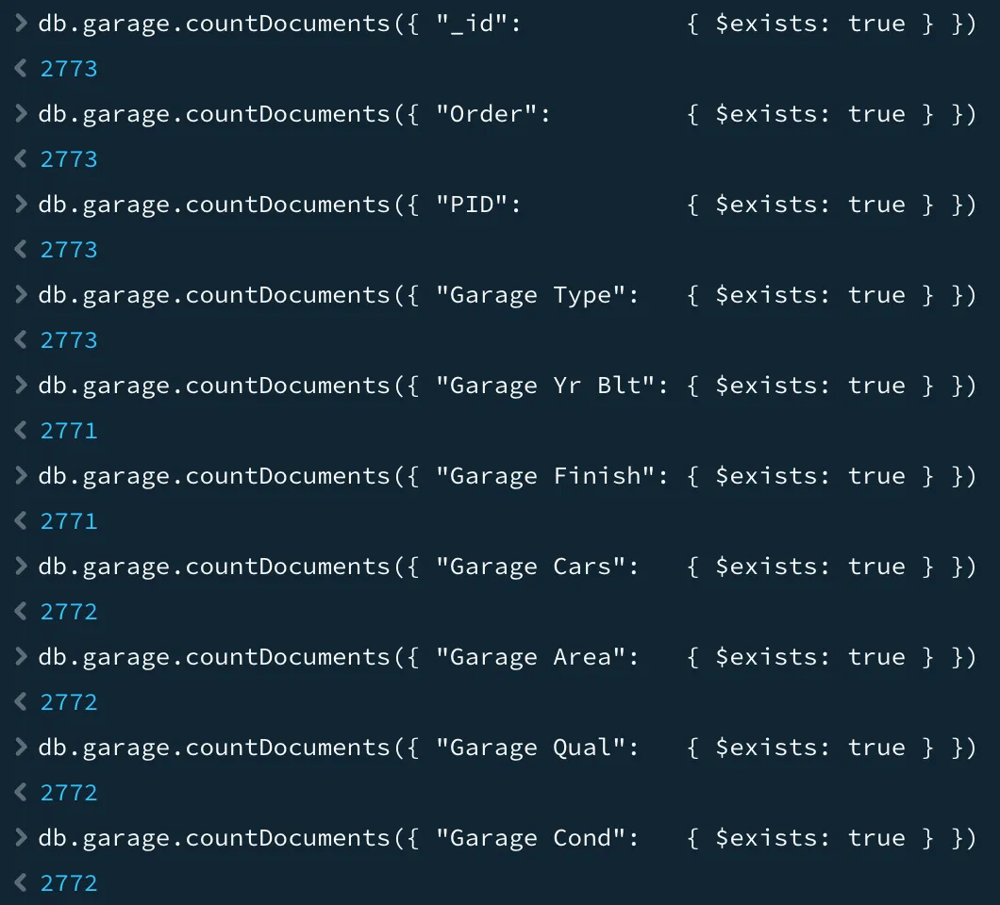

# Reporte del proyecto ETL Ames

## 1. Identificación del proyecto

| Campo | Valor |
|---|---|
| Curso | Ingeniería de Datos I, Unidad 4 (Procesos ETL). Maestría en Ciencia de Datos, Universidad Icesi, 2026-2 |
| Proyecto | Diseño e implementación de un proceso ETL en Azure Data Factory para la integración de fuentes heterogéneas del conjunto de datos Ames. `salida.csv` |
| Equipo | Grupo 7 |
| Integrantes | Mateo Sánchez, Luisa Mosquera, Darío Yépez, Juan Pablo Jiménez, Nathalia Herrera |
| Fecha de entrega | 19 de noviembre de 2026 |
| Repositorio | https://github.com/iiwakashi96/ProyectoETL_Ing_Datos_1 |

## TABLA DE CONTENIDO 

- [1. Identificación del proyecto](#1-identificación-del-proyecto)
- [2. Introducción y objetivo](#2-introducción-y-objetivo)
- [3. Fuentes de datos y exploración](#3-fuentes-de-datos-y-exploración)
- [4. Diseño de la integración](#4-diseño-de-la-integración)
- [5. Transformaciones](#5-transformaciones)
- [6. Implementación en Azure Data Factory](#6-implementación-en-azure-data-factory)
- [7. Validación de `salida.csv`](#7-validación-de-salidacsv)
- [8. Tecnologías utilizadas](#8-tecnologías-utilizadas)
- [9. Resultados, limitaciones y reproducibilidad](#9-resultados-limitaciones-y-reproducibilidad)
- [10. Conclusiones y lecciones aprendidas](#10-conclusiones-y-lecciones-aprendidas)
- [11. Referencias](#11-referencias)
- [Anexos](#anexos)

## 2. Introducción y objetivo

El conjunto de datos Ames describe 2.930 propiedades residenciales vendidas en Ames, Iowa, mediante 81 variables relacionadas con las características del lote, la construcción, las instalaciones y las condiciones de venta [1]. Para el desarrollo del proyecto, la información fue distribuida en diferentes fuentes y tecnologías: un archivo CSV con información del lote y la ubicación, una base de datos relacional PostgreSQL alojada en Neon con la construcción, los pisos y la venta, y cuatro colecciones de MongoDB Atlas correspondientes a garajes, sótanos, piscinas y características adicionales, que no todas las casas tienen. Ninguna fuente por sí sola describe una propiedad completa, y cada una tiene su propia forma de representar ausencias, códigos y tipos. 

Esta distribución representó un reto de integración, debido a las diferencias en las estructuras, los tipos de datos, las llaves de identificación y la forma de representar los valores ausentes. Por esta razón, fue necesario diseñar un proceso ETL que permitiera consolidar la información, aplicar las reglas de transformación establecidas y garantizar la integridad del conjunto de datos resultante.

El objetivo del proyecto fue construir en Azure Data Factory (ADF) un proceso ETL que:

1. extraiga la información de las tres fuentes originales, conservando la integridad de los datos de origen;
2. las integre por la llave `PID` conservando exactamente una fila por cada una de las 2.930
   propiedades, sin perder ni duplicar ninguna;
3. aplique las transformaciones obligatorias del enunciado (área habitable, agregación de
   habitaciones y baños por piso, mes y año de venta, año de remodelación) y las
   transformaciones opcionales de descripción a código;
4. represente las ausencias con `NA` en campos cualitativos y `0` en numéricos;
5. produzca `salida.csv` con los 81 campos en el orden definido, con una convención de
   nombres sin espacios, y lo valide contra las fuentes.

Como resultado, se obtuvo el archivo entregado en `out/salida.csv`, compuesto por 2.930 registros y 81 columnas, que integra la información de las diferentes fuentes en una estructura unificada. Su consistencia fue comprobada mediante el notebook de validación proporcionado en el curso, en el cual se ejecutaron 28 pruebas, todas con resultado APROBADO, cuyos resultados se presentan en la sección 7.

## 3. Fuentes de datos y exploración

La exploración se hizo entre el 28 de octubre y el 11 de noviembre de 2026 con pgAdmin,
MongoDB Compass y scripts de Python (pandas, psycopg2, pymongo), antes de construir el
pipeline. Los tamaños del enunciado se tomaron como referencia y se midieron de nuevo.

### 3.1 Archivo `AmesProperty.csv`

| Aspecto | Observado |
|---|---|
| Ubicación usada por el pipeline | Contenedor `ames` del almacenamiento de Azure, raíz |
| Separador, codificación, encabezado | `;`, UTF-8, primera fila con 19 nombres de columna con espacios |
| Filas y columnas | 2.930 × 19 |
| `PID` | Numérico de 9 dígitos, sin repetidos ni vacíos |
| Campos que aporta | 19: `PID`, `Lot Frontage`, `Lot Area`, `Street`, `Alley`, `Lot Shape`, `Land Contour`, `Utilities`, `Lot Config`, `Land Slope`, `Neighborhood`, `Condition 1`, `Condition 2`, `Bldg Type`, `House Style`, `Overall Qual`, `Overall Cond`, `Year Built`, `Year Remod/Add` |

Problemas de calidad relevantes:

- `Year Remod/Add` vacío en 1.569 filas (la regla del enunciado pide sustituirlo por `Year Built`).
- `Lot Frontage` vacío en 490 filas; el enunciado no dice qué poner.
- `Lot Shape` y `Neighborhood` vienen como descripciones largas (`Slightly irregular`,
  `North Ames`) y no como los códigos del archivo de ejemplo (`IR1`, `Names`).
- `Condition 1` y `Condition 2` mezclan códigos y descripciones en la misma columna
  (`Norm` y `Normal`, `Feedr` y `Adjacent to feeder street`).
- Tres barrios (`Greens`, `GrnHill`, `Landmrk`, 11 casas) no aparecen en la tabla de códigos
  del enunciado.
- `Alley` trae el texto `NA` escrito en 2.732 filas: es un valor, no un vacío.

La revisión de estas inconsistencias permitió identificar que la integración no podía limitarse a combinar las fuentes, sino que requería aplicar reglas específicas de normalización y tratamiento de valores ausentes, manteniendo la trazabilidad respecto a los datos originales.

### 3.2 PostgreSQL en Neon (`amesDB`)

El modelo relacional está en `sources/scriptAmesDB.sql` (DDL de 6 tablas) y en
`sources/Modelos.pdf` (diagrama entidad-relación y relacional). Al revisar las restricciones
declaradas en la base desplegada (catálogo `pg_constraint`) se encontró que solo existen las
llaves primarias y dos llaves foráneas (`saleproperty → amesdbtemp` y
`floordetail → amesdbtemp`). Las seis relaciones que el diagrama dibuja desde `amesdbtemp`
hacia los catálogos no están declaradas, pero los datos las cumplen: cero huérfanos y cero
nulos en las seis columnas. Se trataron como búsquedas implícitas.

| Tabla | Propósito | Llave | Cardinalidad con `PID` | Filas referencia | Filas observadas | Aporta a la salida |
|---|---|---:|---|---:|---:|---|
| `amesdbtemp` | Tabla principal: construcción, exterior, calefacción, cocina, porches | `pid` | 1:1 | 2.930 | 2.930 | 32 columnas |
| `saleproperty` | Venta de cada casa: fecha, tipo, condición, precio | `pid` | 1:1 | 2.930 | 2.930 | 5 columnas (`Mo Sold` y `Yr Sold` derivadas de `Sale Date`) |
| `floordetail` | Dormitorios y baños **por piso** | `pid` + piso | 1:N (1 o 2 filas por casa) | 4.182 | 4.182 | 3 columnas agregadas (`Full Bath`, `Half Bath`, `Bedroom`) |
| `mszoning` | Catálogo de zonificación: id → código | `id` | catálogo | 8 | 8 | código de `MS Zoning` |
| `typequality` | Catálogo de calidades: 1 Ex, 2 Gd, 3 TA, 4 Fa, 5 Po | `id` | catálogo | 5 | 5 | códigos de `Exter Qual`, `Exter Cond`, `Heating QC`, `Kitchen Qual` |
| `mssubclass` | Catálogo de tipos de vivienda | `code` | catálogo | 16 | 16 | ninguna (la salida conserva el número) |

La exploración de PostgreSQL permitió establecer que las tablas `amesdbtemp` y `saleproperty` presentan una relación uno a uno con `PID`, mientras que `floordetail` presenta una relación de uno a muchos, debido a que registra información desagregada por piso. Esta diferencia fue determinante para definir la estrategia de integración, ya que fue necesario agregar previamente los registros de `floordetail` para evitar la multiplicación de propiedades durante las uniones.

Hallazgos:

- `amesdbtemp` guarda las cuatro variables de calidad y la zonificación como **números**
  (identificadores de catálogo), no como códigos; la salida exige códigos.
- `floordetail` es la única tabla con más de una fila por propiedad: 2.930 casas en 4.182
  filas. Unirla sin agregar primero multiplicaría propiedades.
- `Mas Vnr Type` y `Mas Vnr Area` nulos en 23 filas, `Electrical` nulo en 1. El enunciado no
  lo menciona; se decidió aplicar la misma regla de `NA` y `0`.
- `Central Air` es booleano en la base y `Y`/`N` en la salida.
- `Sale Type` trae el valor `WD ` con un espacio final en 2.536 filas.
- Tres códigos de `mszoning` traen paréntesis (`A (agr)`, `C (all)`, `I (all)`, 29 casas); se
  dejaron como están en el catálogo.
- La ausencia de dato se representa de tres formas distintas: `NULL` (las 47 celdas
  anteriores), el texto `NA` (`fence`: 2.358; `Fireplace Qu`: 1.422) y el texto `None`
  (`Mas Vnr Type`: 1.752). Una consulta con `IS NULL` subestima los faltantes:
  `Fireplace Qu` no tiene nulos, aunque el 48,5 % de las casas no tiene chimenea. Los
  textos `NA` y `None` son valores válidos de la fuente y se conservaron en la salida.
- El usuario compartido de la base tiene permisos de lectura y escritura (`SELECT` e
  `INSERT`). La exploración y la extracción usaron solo consultas `SELECT`; para un ETL
  en producción se recomienda un usuario de solo lectura.

Evidencia: Anexo E, figuras E.1 a E.6.

### 3.3 MongoDB Atlas (`test`)

| Colección | Documentos referencia | Documentos observados | `PID` | Duplicados / sin PID | Casas sin documento | Aporta a la salida |
|---|---:|---:|---|---|---:|---|
| `garage` | 2.773 | 2.773 | numérico (`$numberLong`) | 0 / 0 | 157 | 7 columnas |
| `bsmt` | 2.851 | 2.851 | numérico (`$numberLong`) | 0 / 0 | 79 | 11 columnas |
| `pool` | 13 | 13 | numérico (`$numberLong`) | 0 / 0 | 2.917 | 2 columnas |
| `misc` | 106 | 106 | numérico (`$numberLong`) | 0 / 0 | 2.824 | 2 columnas |

Hallazgos:

- Cada colección tiene **cero o un** documento por propiedad: la ausencia de documento
  significa que la casa no tiene garaje, sótano, piscina o extras.
- Dentro de un documento pueden faltar campos sueltos (por ejemplo, 3 casas con sótano sin
  `Bsmt Exposure`). Hay que distinguir documento ausente, campo ausente y cero válido:
  `Garage Cars = 0` nunca aparece en la fuente, porque una casa sin garaje no tiene
  documento; el `0` de la salida es, por tanto, siempre un marcador de ausencia.
- Los números vienen envueltos en el tipo extendido de Mongo (`{"$numberLong": "..."}`), que
  ADF expone como columnas con sufijo `_$numberLong`.
- `garage` trae un campo `Order` que no forma parte de la salida.
- Hay documentos existentes con datos incompletos o contradictorios. En `bsmt`, la casa
  903230120 tiene documento pero ningún dato de sótano, solo `_id` y `PID`; en la salida
  queda con `NA` y `0`, igual que una casa sin sótano, aunque no es posible saber si lo
  tiene. En `garage`, la casa 903426160 registra 1 carro y 360 pies², pero `Garage Qual`
  y `Garage Cond` traen el texto `NA`; la salida conserva esos valores tal como vienen
  de la fuente.
- En `misc`, 3 documentos registran una característica con `Misc Val = 0`. Es un caso
  ambiguo: no se puede saber si el valor es realmente cero o si no se registró.

Evidencia: Anexo E, figuras E.7 y E.8.

### 3.4 Síntesis de la exploración

| Fuente y objeto | Llave | Cardinalidad con `PID` | Tamaño observado | Problema de calidad | Aporte |
|---|---|---|---:|---|---|
| CSV `AmesProperty.csv` | `PID` | 1:1 | 2.930 | vacíos en `Year Remod/Add` (1.569) y `Lot Frontage` (490); descripciones en vez de códigos | 19 columnas |
| PG `amesdbtemp` | `pid` | 1:1 | 2.930 | calidades y zona como id numérico; 23 nulos en `Mas Vnr` | 32 columnas |
| PG `saleproperty` | `pid` | 1:1 | 2.930 | fecha completa; `WD ` con espacio | 5 columnas |
| PG `floordetail` | `pid` + piso | 1:N | 4.182 | varias filas por casa | 3 agregadas |
| PG catálogos | `id` | — | 8, 5, 16 | relaciones no declaradas | códigos |
| Mongo `garage`, `bsmt`, `pool`, `misc` | `PID` | 0..1 | 2.773, 2.851, 13, 106 | documentos ausentes; campos ausentes; `$numberLong` | 22 columnas |

Hallazgos que cambiaron el diseño: (a) la cardinalidad 1:N de `floordetail` obligó a agregar
por `PID` antes de unir; (b) los identificadores numéricos de calidad y zona obligaron a
unir con los catálogos; (c) la cobertura parcial de las colecciones de Mongo (desde 13 hasta
2.851 casas) obligó a usar uniones externas izquierdas y a rellenar `NA` y `0` después de
unir; (d) el `PID` llega como texto desde el CSV y como número desde las demás fuentes, lo
que exigió fijar el tipo antes de unir.

En conjunto, la exploración permitió establecer las condiciones necesarias para diseñar el proceso de integración. Se identificaron diferencias en los tipos de datos de las llaves, relaciones de uno a muchos, cobertura parcial de las colecciones documentales y distintas representaciones de valores ausentes. Estos hallazgos orientaron la selección de las uniones externas izquierdas, la agregación previa de los registros de `floordetail`, la normalización de los tipos de `PID` y la aplicación de reglas específicas para completar los datos faltantes.

## 4. Diseño de la integración

**Universo de propiedades.** Lo define `AmesProperty.csv`: contiene las 2.930 propiedades, una por fila y sin `PID` repetidos. Por esta razón, se utilizó como fuente izquierda o conjunto base de la integración. Todas las demás fuentes se incorporaron tomando `PID` como llave de correspondencia, con el propósito de completar la información de cada propiedad sin agregar ni eliminar registros del conjunto original.

**Dónde se hace cada cosa.** Se repartió el trabajo entre la base relacional y el flujo de
datos de ADF según dónde fuera más natural y verificable:

- En PostgreSQL, mediante una consulta de origen (`pipelines/dataflow/df_ames.dsl`, origen
  `postgres`): los cinco `JOIN` con catálogos, la agregación de `floordetail`, el cálculo
  de `Gr Liv Area`, la extracción de mes y año, `Central Air` a `Y`/`N` y el `COALESCE` de
  los nulos. La consulta devuelve exactamente 2.930 filas con `PID` y 40 columnas, y se probó
  en pgAdmin antes de usarla en ADF.
- En ADF, en el flujo `df_ames`: la copia previa de Mongo, las cinco uniones por `PID`, el
  relleno de ausencias de Mongo, `Year Remod/Add`, `Lot Frontage`, las transformaciones
  opcionales, el renombrado y el orden final.

**Tabla de decisiones de unión** (todas en el flujo `df_ames`, llave `PID`):

| Paso | Entrada izquierda | Entrada derecha | Preparación previa | Tipo de unión | Filas antes → después | Justificación |
|---|---|---|---|---|---|---|
| `unirPostgres` | `csv` (2.930) | consulta PostgreSQL (2.930) | `PID` del CSV convertido a `long`; agregación de `floordetail` y catálogos resueltos en la consulta | externa izquierda | 2.930 → 2.930 | 1:1; la externa izquierda protege ante cualquier `PID` faltante en la base |
| `unirPool` | resultado anterior | `staging/pool.csv` (13) | copia previa con `pl_copia_mongo`; `_id` excluido; `PID` renombrado | externa izquierda | 2.930 → 2.930 | 0..1; una interna dejaría 13 casas |
| `unirGarage` | resultado anterior | `staging/garage.csv` (2.773) | igual; `Order` excluido | externa izquierda | 2.930 → 2.930 | 0..1; 157 casas sin garaje |
| `unirBsmt` | resultado anterior | `staging/bsmt.csv` (2.851) | igual | externa izquierda | 2.930 → 2.930 | 0..1; 79 casas sin sótano |
| `unirMisc` | resultado anterior | `staging/misc.csv` (106) | igual | externa izquierda | 2.930 → 2.930 | 0..1; 2.824 casas sin extras |

**Comprobaciones de integridad.** Para verificar que las uniones no multiplicaran registros, durante la exploración se revisó la cardinalidad de las fuentes respecto a `PID` y se agregó previamente `floordetail`, garantizando una sola fila por propiedad antes de integrarla. Posteriormente, durante la ejecución de ADF, se confirmó que el resultado de `unirMisc` y el receptor reportaran 2.930 filas.

Para comprobar que no se eliminaran propiedades, se ejecutó una prueba de cobertura en el notebook de validación, comparando los `PID` de `salida.csv` con los del archivo base `AmesProperty.csv`. El resultado fue de cero identificadores faltantes y cero adicionales, confirmando que se conservaron las 2.930 propiedades originales.


***Figura 1.*** *Flujo de datos `df_ames`: 6 orígenes, 5 uniones, transformaciones y salida.*

## 5. Transformaciones

### 5.1 Área habitable

La variable `Gr Liv Area` no se encuentra directamente en las fuentes y se construyó mediante la suma de las áreas correspondientes al primer piso, segundo piso y área terminada de baja calidad.

El cálculo se realizó en la consulta de origen de PostgreSQL mediante la expresión:

`a."1st Flr SF" + a."2nd Flr SF" + a."Low Qual Fin SF"`. 

Las tres columnas son de tipo entero y no presentan valores nulos en `amesdbtemp`, por lo que no fue necesario aplicar un tratamiento adicional de valores ausentes.

**Validación:** el notebook recalculó la suma para cada propiedad y comparó el resultado con el valor generado en Gr Liv Area. Se obtuvieron cero filas con diferencias.

### 5.2 Habitaciones y baños

La tabla `floordetail` contiene información desagregada por piso para cada propiedad, con los campos `bedrooms`, `"Full Bath"` y `"Half Bath"`. Debido a esta estructura, fue necesario realizar una agregación por `PID` antes de integrar la información con la tabla principal `amesdbtemp`.

La agregación se implementó en la consulta de origen de PostgreSQL mediante la función `SUM()` y la cláusula `GROUP BY pid`, sumando los dormitorios, baños completos y baños medios registrados en los diferentes pisos de cada propiedad.

Esta operación permitió transformar los 4.182 registros originales de `floordetail` en una estructura de una fila por propiedad, con 2.930 registros, evitando la multiplicación de filas durante la integración.

Para los casos sin registro en `floordetail`, se contempló el uso de `COALESCE` para asignar el valor 0; sin embargo, durante la exploración no se identificaron propiedades sin registros en esta tabla.

**Validación:** el notebook realizó nuevamente la suma de los registros originales de `floordetail` por `PID` y comparó los resultados con las columnas `bedroom`, `full_bath` y `half_bath` generadas en la integración. Se obtuvieron cero diferencias en los tres campos.

### 5.3 Fecha de venta

La tabla `saleproperty` contiene el campo `Sale Date`, cuyo tipo de dato original es fecha. A partir de este campo se generaron las variables `Mo Sold` y `Yr Sold`, correspondientes al mes y al año de la venta, respectivamente. 

El cálculo se realizó en la consulta de origen de PostgreSQL mediante la función `EXTRACT`, convirtiendo los resultados a tipo entero:

- Mes: `CAST(EXTRACT(MONTH FROM s."Sale Date") AS integer)`.
- Año: `CAST(EXTRACT(YEAR FROM s."Sale Date") AS integer)`.

La fecha completa no se incorporó a la salida, ya que se requerían únicamente las variables de mes y año.

**Validación:** el notebook tomó las fechas originales de `saleproperty`, calculó nuevamente el mes y el año y comparó los resultados por `PID` con las columnas generadas durante la integración. Se obtuvieron cero diferencias.

### 5.4 Fecha de remodelación

Durante la exploración del archivo `AmesProperty.csv` se identificaron 1.569 propiedades sin información en el campo `Year Remod/Add`. Para atender esta situación, se aplicó una regla de sustitución que conserva el año de remodelación original cuando está disponible y utiliza `Year Built` únicamente cuando el primer campo está vacío.

La transformación se implementó en la caja `arreglar` del flujo de datos `df_ames`, mediante la expresión `iifNull({Year Remod/Add}, {Year Built})`.

De esta manera, los valores existentes de `Year Remod/Add` se conservaron sin modificaciones, mientras que los registros ausentes se completaron con el año de construcción de la propiedad.

**Validación:** el notebook reconstruyó el valor esperado para cada propiedad a partir del archivo CSV original: conservó `Year Remod/Add` cuando tenía información y utilizó `Year Built` cuando estaba vacío. Posteriormente, comparó el resultado esperado con la columna generada en la integración, utilizando `PID` como identificador. Se obtuvieron 0 diferencias y ninguna propiedad quedó con valores vacíos o en 0.

### 5.5 Variables de calidad y catálogos

| Columna de salida | Columna origen (`amesdbtemp`) | Catálogo | Unión | Cardinalidad | Códigos sin correspondencia |
|---|---|---|---|---|---|
| `MS_zoning` | `"MS Zoning"` (id) | `mszoning.id → code` | `LEFT JOIN` | 1:1 | 0 |
| `exter_qual`, `exter_cond`, `heating_QC`, `kitchen_qual` | ids | `typequality.id → code` | 4 `LEFT JOIN` con alias | 1:1 | 0 |

Se utilizaron uniones `LEFT JOIN` para conservar todos los registros de `amesdbtemp`, incluso si algún identificador no encontraba correspondencia en los catálogos. La relación esperada para cada unión era de uno a uno, dado que cada identificador debía corresponder a un único código de referencia.

Durante la exploración se comprobó que las relaciones con los catálogos no presentaban registros huérfanos ni valores nulos en las columnas utilizadas para las correspondencias. Por esta razón, no fue necesario aplicar un tratamiento adicional para códigos sin correspondencia.

**Validación:** el notebook realizó nuevamente la búsqueda de correspondencias contra el catálogo `typequality` y comparó los resultados por `PID` con las cuatro columnas de calidad generadas (`exter_qual`, `exter_cond`, `heating_QC` y `kitchen_qual`). Se obtuvieron 0 diferencias.

### 5.6 Datos ausentes de MongoDB

Las cuatro colecciones de MongoDB (`garage`, `bsmt`, `pool` y `misc`) presentan propiedades sin documentos asociados y, en algunos casos, documentos existentes con campos ausentes. Para integrar esta información se utilizaron uniones externas izquierdas (`LEFT JOIN`), de manera que se conservaran las 2.930 propiedades del archivo base, incluso cuando no existía información en alguna colección.

Después de realizar las uniones, las 22 columnas provenientes de MongoDB podían presentar valores nulos debido a la ausencia de documentos, campos o valores en las fuentes. Para estandarizar estos casos, en la caja `arreglar` del flujo `df_ames` se aplicaron 22 expresiones `iifNull`: se asignó `'NA'` a las 11 variables cualitativas y `0` a las 11 variables numéricas.

Durante la exploración se identificaron diferentes situaciones que justificaron este tratamiento:

- **Documento ausente:** ocurre cuando una propiedad no tiene registro en una colección. Por ejemplo, 2.917 propiedades no tienen documento en `pool`.
- **Campo ausente dentro de un documento existente:** se identificaron 3 propiedades con documentos de sótano que no contienen el campo `Bsmt Exposure`.
- **Valor cero válido:** algunos campos numéricos ya contienen el valor `0` en la fuente, como `BsmtFin SF 2` cuando no existe una segunda área de sótano terminada. Estos valores se conservaron porque la función `iifNull` solamente reemplaza valores nulos.

Es importante señalar que la transformación asigna los mismos marcadores (`NA` y `0`) tanto a los documentos ausentes como a los campos ausentes. Por lo tanto, la salida estandariza estas situaciones, aunque no conserva una distinción explícita entre sus causas originales.

**Validación:** el notebook comparó las 22 columnas provenientes de MongoDB con los documentos originales de las cuatro colecciones, utilizando `PID` como identificador. Se verificaron los valores existentes y los marcadores asignados a los datos ausentes, obteniendo 0 diferencias.

### 5.7 Transformaciones opcionales

Se aplicaron transformaciones de descripción a código en las cuatro variables `neighborhood`, `condition_1`, `condition_2` y `lot_shape`, utilizando las tablas de correspondencias proporcionadas en el enunciado. Estas operaciones se implementaron mediante expresiones `case` en la caja `arreglar` del flujo de datos `df_ames`.

Las reglas aplicadas fueron las siguientes:

- **`neighborhood`:** se implementaron 21 reglas `case` para convertir las descripciones de los barrios a sus respectivos códigos. Por ejemplo, `North Ames` se convirtió en `Names` y `College Creek` en `CollgCr`. Cuatro barrios (`Edwards`, `Gilbert`, `Sawyer` y `Veenker`) ya tenían la misma descripción y código, por lo que se conservaron sin modificación. Otros tres (`Greens`, `GrnHill` y `Landmrk`) no estaban incluidos en la tabla de correspondencias del enunciado y se conservaron mediante la rama por defecto de la expresión.
- **`condition_1` y `condition_2`:** se aplicaron nueve reglas de conversión de descripciones a códigos. Los valores que ya se encontraban expresados en código se conservaron sin cambios.
- **`lot_shape`:** se convirtieron las descripciones `Regular`, `Slightly irregular`, `Moderately Irregular` e `Irregular` a los códigos `Reg`, `IR1`, `IR2` e `IR3`, respectivamente.

Las tablas de correspondencias utilizadas se presentan en el Anexo C.

**Validación:** el notebook verificó que cada una de las cuatro columnas presentara una codificación consistente, es decir, que utilizara los códigos definidos en lugar de mezclar descripciones y códigos. Las cuatro variables fueron identificadas como consistentes con los códigos establecidos.

### 5.8 Otras reglas aplicadas

Además de las transformaciones descritas anteriormente, se aplicaron otras reglas para completar el tratamiento de valores ausentes, estandarizar algunos campos y cumplir con la estructura requerida para el archivo final.

- **`lot_frontage`:** se identificaron 490 propiedades con valores vacíos en esta columna del archivo CSV. Se asignó el valor `0` mediante una condición `isNull` en la caja `arreglar`, siguiendo la regla de representación de valores numéricos ausentes.

- **`mas_vnr_type`, `mas_vnr_area` y `electrical`:** en la tabla `amesdbtemp` se encontraron 23 valores nulos en `Mas Vnr Type`, 23 en `Mas Vnr Area` y 1 en `Electrical`. Se reemplazaron por `NA` en las variables cualitativas y por `0` en la variable numérica, respectivamente.

- **`central_air`:** el campo original se encontraba almacenado como valor booleano en PostgreSQL. Se convirtió a los valores `Y` y `N` mediante una expresión `CASE` en la consulta de origen, de acuerdo con el formato requerido para la salida.

- **`sale_type`:** se identificaron 2.536 registros con el valor `WD` seguido de un espacio al final. Se aplicó la función `trim` en la caja `arreglar` para eliminar los espacios sobrantes y estandarizar los valores de la columna.

- **Nombres de columnas:** en la caja `ordenar` se renombraron los 81 campos de salida utilizando la convención `snake_case`, sin espacios y respetando las excepciones de mayúsculas establecidas para `PID`, `MS` y `QC`. También se definió el orden de las columnas de acuerdo con el formato exigido por el notebook de validación del curso.

**Validación:** estas reglas se verificaron mediante el notebook de validación. Se comprobaron los marcadores de valores ausentes, la correspondencia de `Central Air`, la ausencia de espacios sobrantes en los valores y la coincidencia de los 81 encabezados con los nombres y el orden requeridos.

### Matriz de transformaciones

| Campo de salida | Fuente y campo original | Regla | Implementación en ADF | Faltantes | Validación |
|---|---|---|---|---|---|
| `gr_liv_area` | PG `amesdbtemp`: 1st, 2nd, Low Qual | suma | consulta de origen | no aplica | por fila, notebook |
| `bedroom`, `full_bath`, `half_bath` | PG `floordetail` por piso | suma por `PID` | subconsulta `GROUP BY` en origen | `COALESCE 0` | por `PID`, notebook |
| `mo_sold`, `yr_sold` | PG `saleproperty.Sale Date` | mes y año | `EXTRACT` en origen | no aplica | por `PID`, notebook |
| `year_remod_add` | CSV | vacío → `Year Built` | `iifNull` en `arreglar` | 1.569 casos | por `PID`, notebook |
| `MS_zoning`, 4 calidades | PG ids | id → código | `LEFT JOIN` catálogos en origen | 0 huérfanos | por `PID`, notebook |
| 22 columnas de Mongo | Atlas `garage`, `bsmt`, `pool`, `misc` | ausente → `NA`/`0` | `iifNull` en `arreglar` | 157 / 79 / 2.917 / 2.824 casas | por `PID`, notebook |
| `neighborhood`, `condition_1`, `condition_2`, `lot_shape` | CSV descripciones | → código | `case` en `arreglar` | no aplica | consistencia completa, notebook |
| `lot_frontage` | CSV | vacío → `0` | `iif(isNull... )` en `arreglar` | 490 | marcadores, notebook |
| `central_air` | PG booleano | → `Y`/`N` | `CASE` en origen | no aplica | ejemplo de la profesora |
| `sale_type` | PG | quitar espacio final | `trim` en `arreglar` | no aplica | espacios, notebook |
| 81 encabezados | — | snake_case sin espacios | renombrado en `ordenar` | — | encabezados, notebook |

## 6. Implementación en Azure Data Factory

**Extracción por fuente.**

| Fuente | Servicio vinculado | Conjunto de datos | Mecanismo de extracción | Destino intermedio | Filas leídas |
|---|---|---|---|---|---:|
| `AmesProperty.csv` | `BlobAmes` | `ds_csv_ames` | Origen `csv` del flujo `df_ames`, `PID` proyectado como `long` | — | 2.930 |
| PostgreSQL (`amesDB`) | `NeonConn` | `ds_pg_ames` | Origen `postgres` de `df_ames` con consulta (catálogos, agregación de `floordetail`, cálculos) | — | 2.930 × 40 columnas |
| MongoDB `pool`, `garage`, `bsmt`, `misc` | `MongoConn` | `ds_mongo_*` | Copiar datos en `pl_copia_mongo` (excluye `_id` y `Order`, renombra `_$numberLong`) | `ames/staging/*.csv` (`ds_stg_*`) | 13 / 2.773 / 2.851 / 106 |

**Servicios vinculados** (sin parámetros sensibles en el repositorio): `BlobAmes` (Azure
Blob Storage con espacio de nombres jerárquico, contenedor `ames`), `NeonConn`
(Azure Database for PostgreSQL apuntando al servidor de Neon, base `amesDB`, SSL
obligatorio) y `MongoConn` (MongoDB Atlas, base `test`).

**Conjuntos de datos.** `ds_csv_ames` (CSV de entrada), `ds_pg_ames` (PostgreSQL),
`ds_mongo_pool|garage|bsmt|misc` (colecciones), `ds_stg_pool|garage|bsmt|misc` (copias
CSV en `ames/staging/`) y `ds_salida` (CSV en `ames/salida/`, separador `;`, encabezado,
UTF-8).

**Canalización `pl_copia_mongo`** (patrón EL). Cuatro actividades Copiar datos
independientes, de cada colección a su CSV de `staging`. En la asignación de columnas se
excluyó `_id` (y `Order` en `garage`) y se renombraron los campos `_$numberLong` a su nombre
original. Se eligió copiar a CSV antes de unir porque el flujo de datos trata mejor archivos
delimitados que el conector de Mongo, y porque deja una copia inspeccionable de la fuente
documental en el Data Lake (zona cruda). Ejecutada el 16 de noviembre: 13, 2.773, 2.851 y
106 filas leídas y escritas.

**Canalización `pl_ames_etl`** (patrón ETL). Una actividad Flujo de datos,
`unir_y_transformar`, que ejecuta `df_ames`. El flujo tiene 14 cajas en secuencia:

| Caja | Tipo | Función |
|---|---|---|
| `csv`, `postgres`, `pool`, `garage`, `bsmt`, `misc` | Origen | Lectura de las seis entradas; en `csv`, `PID` proyectado como `long`; en `postgres`, la consulta de origen |
| `unirPostgres` … `unirMisc` | Unión | Cinco uniones externas izquierdas por `PID`, en cadena desde el CSV |
| `arreglar` | Columna derivada | 29 expresiones: 22 `iifNull` de Mongo, `Year Remod/Add`, `Lot Frontage`, `Sale Type`, 4 `case` de códigos |
| `ordenar` | Seleccionar | Un solo `PID` (se descartan los cinco repetidos de las uniones), orden de las 81 columnas y renombrado a snake_case |
| `salida` | Receptor | `ds_salida`, una sola partición y nombre fijo `salida.csv` |

Las definiciones completas están en `pipelines/` (JSON de cada objeto, el script `.dsl`
del flujo con todas las expresiones, y la plantilla ARM de la fábrica).

**Ejecución y monitoreo.** Las canalizaciones se ejecutaron con Depurar desde Data Factory
Studio con la depuración de flujo de datos activa, y se revisaron en la pestaña Salida y
en Monitor. Última ejecución de `pl_ames_etl`: 19 de noviembre de 2026, estado Correcto,
2.930 filas leídas en `csv` y `postgres`, 13, 2.773, 2.851 y 106 en las copias de Mongo,
2.930 filas escritas en `salida`.



***Figura 2.*** *Canalización `pl_copia_mongo`: cuatro actividades de copia de las colecciones de MongoDB a `staging/`.*



***Figura 3.*** *Canalización `pl_ames_etl`: actividad que ejecuta el flujo de datos `df_ames`.*


***Figura 4.*** *Monitor de Data Factory con la ejecución correcta de la canalización.*

**Problemas resueltos durante la implementación.**

| Problema | Causa | Decisión |
|---|---|---|
| Las uniones no encontraban coincidencias | `PID` llegaba como texto desde el CSV y como número desde las otras fuentes | Proyección de `PID` a `long` en el origen `csv` |
| La vista previa mostraba casi todo en nulo | La vista previa usa una muestra de 1.000 filas por origen, así que la unión solo coincidía en pocas casas | Subir el límite de depuración a 3.000 filas; la ejecución real lee todo |
| ADF infirió `Bsmt Half Bath` como booleano | En la muestra solo vio valores 0 y 1 | Fijar el tipo numérico en la proyección |
| No se podía publicar el flujo a medio construir | ADF no publica un flujo sin receptor | Construir primero un flujo mínimo origen→receptor y publicar; luego insertar las cajas intermedias |
| Error de conexión a PostgreSQL | Nombre de base mal escrito (`amesBD`) | Corregir a `amesDB` en `NeonConn` |
| El 17 de noviembre la base rechazó todas las conexiones | La cuenta gratuita de Neon del curso agotó su cuota | Se preparó un plan de contingencia (las 40 columnas de PostgreSQL en un CSV, obtenido de una ejecución local anterior); no fue necesario porque la docente recargó la cuota el 18 |
| La depuración "terminó bien" pero no apareció `salida.csv` | Se había ejecutado la depuración del flujo (solo muestras), no la de la canalización | Ejecutar Depurar desde la canalización `pl_ames_etl` |
| Al pegar el bloque de `ordenar` el flujo quedó roto | Tres nombres nuevos empiezan por número (`1st_flr_sf`, `2nd_flr_sf`, `3ssn_porch`) y en el script deben ir entre llaves | Corregir el bloque y restaurar el receptor |

## 7. Validación de `salida.csv`

**Estrategia.** Tres niveles: (1) durante la exploración, reglas y conteos calculados fuera
de ADF, que sirvieron de salida esperada; (2) comparación celda por celda del archivo
producido por ADF contra esa salida esperada y contra las tres propiedades del archivo de
ejemplo del enunciado; (3) el notebook de autovalidación del curso
(`notebooks/validar_salida_ames.ipynb`, `NAMING_STYLE = "snake_case"`, comparación con
fuentes activada), ejecutado sobre el archivo final.

**Resultados de la última ejecución** (19 de noviembre de 2026):

| Verificación | Método | Resultado observado | Estado | Evidencia o corrección |
|---|---|---|---|---|
| Dimensiones | notebook | 2.930 filas × 81 columnas | APROBADO | — |
| `PID` válido y único | notebook | 0 inválidos, 0 duplicados | APROBADO | — |
| Cobertura de `PID` frente al CSV | notebook | 0 faltantes, 0 adicionales | APROBADO | — |
| Encabezados exactos y orden (snake_case) | notebook | 81 coincidencias | APROBADO | corrección: la primera versión tenía nombres con espacios |
| Encabezados sin duplicados ni espacios | notebook | 0 | APROBADO | — |
| Marcadores de faltantes y tipos | notebook | solo `NA` en cualitativos y numéricos en numéricos | APROBADO | corrección: `lot_frontage` vacío en 490 filas → `0` |
| Espacios alrededor de valores | notebook | 0 | APROBADO | corrección: `trim` en `sale_type` |
| `gr_liv_area` por fila | notebook | 0 filas con diferencia | APROBADO | — |
| `year_remod_add` sin `0` y contra la fuente | notebook | 0 diferencias | APROBADO | — |
| Agregación de `floordetail` | notebook | 0 diferencias en 3 campos | APROBADO | — |
| Mes y año de `Sale Date` | notebook | 0 diferencias | APROBADO | — |
| Opcionales: `neighborhood`, `condition_1`, `condition_2`, `lot_shape` | notebook | códigos completos y consistentes | APROBADO | corrección: `NAmes` → `Names` (443 casas) |
| Códigos de calidad (`typequality`) | notebook | 0 diferencias en 4 campos | APROBADO | — |
| Mongo: cardinalidad y valores de 4 colecciones | notebook | 0 duplicados, 0 diferencias en 22 campos | APROBADO | — |
| Tres casas del archivo de ejemplo | comparación propia | 81 valores iguales en las 3 | APROBADO | — |


***Figura 5.*** *Resumen del notebook de validación: los siete criterios de la rúbrica en estado APROBADO.*


***Figura 6.*** *Detalle de las 28 pruebas ejecutadas por el notebook de validación, todas en estado APROBADO.*

**Errores encontrados y corregidos.** La primera versión del archivo (18 de noviembre)
reproducía exactamente el archivo de ejemplo del enunciado, con nombres de columna con
espacios y el código `NAmes`. Al ejecutar el notebook del curso aparecieron cuatro
hallazgos: encabezados con espacios (criterio 3, ERROR), `Lot Frontage` vacío (criterio 2,
ERROR), `NAmes` en vez de `Names` (criterio 5, ERROR) y espacios finales en `Sale Type`
(ADVERTENCIA). Se corrigieron en el flujo (`ordenar` y `arreglar`), se volvió a ejecutar la
canalización y la segunda validación quedó completa en APROBADO. El notebook con sus
salidas está en el repositorio.

## 8. Tecnologías utilizadas

| Tecnología | Función concreta en el proyecto |
|---|---|
| Azure Data Factory | Orquestación e integración: dos canalizaciones, un flujo de datos con uniones y transformaciones |
| Azure Blob Storage con espacio de nombres jerárquico (Data Lake Storage Gen2) | Contenedor `ames`: CSV de entrada (zona cruda), copias de Mongo en `staging/` y salida en `salida/` |
| PostgreSQL 17 en Neon | Base relacional `amesDB`; la consulta de origen resuelve catálogos y agregaciones |
| MongoDB Atlas | Base documental `test` con las cuatro colecciones |
| pgAdmin, MongoDB Compass | Exploración de estructura, conteos y pruebas de la consulta de origen |
| Python 3 (pandas, psycopg2, pymongo) | Conteos de la exploración y salida esperada para la comparación celda por celda |
| Jupyter / VS Code | Ejecución del notebook de validación del curso |
| GitHub y GitHub Desktop | Control de versiones, trabajo en equipo y entrega |

## 9. Resultados, limitaciones y reproducibilidad

- **Resultado:** `out/salida.csv`, con 2.930 filas y 81 columnas, nombres en snake_case, separador `;` y codificación UTF-8. El archivo no contiene celdas vacías y utiliza los marcadores `NA` y `0` según las reglas de tratamiento de faltantes definidas para el proyecto. Fue validado el 19 de noviembre de 2026.
- **Fuentes:** las entregadas por el curso para 2026-2, copiadas en `sources/`.
- **Artefactos:** `pipelines/` (JSON, `.dsl`, plantilla ARM), `notebooks/` (notebook con
  resultados), `out/` (archivo y descripción).
- **Parámetros no sensibles para reproducir:** contenedor `ames`; rutas `staging/` y
  `salida/`; consulta de origen incluida en el `.dsl`; `NAMING_STYLE = "snake_case"`.
- **Limitaciones:** la cuota gratuita de Neon es compartida por el curso y puede agotarse;
  la ejecución depende de que la base esté disponible. La exportación de ADF no incluye las
  credenciales, que deben configurarse al importar la plantilla.
- **Verificaciones no ejecutadas:** ninguna; las 28 pruebas del notebook se evaluaron.

## 10. Conclusiones y lecciones aprendidas

1. **La cardinalidad decide la unión.** Conservar una fila por propiedad dependió de dos
   decisiones tomadas antes de unir: agregar `floordetail` por `PID` dentro de la consulta de
   origen y usar uniones externas izquierdas con las colecciones de Mongo. Una unión interna
   con `pool` habría dejado 13 casas; unir `floordetail` sin agregar habría producido 4.182.
2. **Las fuentes heterogéneas no coinciden ni en los tipos de la llave.** `PID` llegó como
   texto desde el CSV, como entero desde PostgreSQL y como `$numberLong` desde Mongo; sin
   fijar el tipo, las uniones devolvían nulos en silencio.
3. **La vista previa engaña.** Las muestras de 1.000 filas hicieron parecer que las uniones
   fallaban cuando solo coincidían pocas casas. Aprendimos a validar con la ejecución real y
   con conteos, no con lo que se ve en pantalla.
4. **Ausencia no es lo mismo que cero.** En MongoDB, una propiedad puede no tener documento en una colección, un documento existente puede tener campos ausentes y algunos campos pueden contener ceros que representan valores válidos. La aplicación de `iifNull` después de las uniones permitió asignar los marcadores definidos para los valores ausentes sin reemplazar los ceros existentes. Esta decisión fue importante para conservar la información disponible y mantener la estructura esperada de la salida. 
5. **Validar contra el ejemplo no basta.** La primera salida era idéntica al archivo de
   ejemplo y aun así falló el notebook del curso en nombres, `Lot Frontage` y `Names`. La
   validación debe hacerse contra la especificación con la que se califica, y debe repetirse
   después de cada cambio.
6. **El script de ADF tiene reglas propias.** Los nombres con espacios o que empiezan por
   número van entre llaves; omitirlas rompió el flujo y borró el receptor. Guardar el bloque
   corregido y probar en un flujo mínimo antes de pegar evitó repetirlo.
7. **Dependencias externas.** La cuota compartida de Neon detuvo el proyecto un día. Tener
   una salida esperada calculada localmente permitió preparar un plan de contingencia y
   seguir validando sin conexión.
8. **La coordinación también hace parte del proceso ETL.** Trabajar sobre un único repositorio y mantener una fábrica como fuente de verdad ayudó a evitar inconsistencias entre los archivos y las configuraciones del equipo. También fue importante acordar quién podía modificar los archivos binarios, como el notebook, y compartir avances mediante mensajes cortos después de completar cada actividad.

### Sugerencias de mejora

9. **Para una siguiente versión**, utilizaríamos un solo conector de PostgreSQL de la misma versión en todas las fábricas del equipo, almacenaríamos las credenciales en Azure Key Vault para facilitar la conexión de la fábrica a Git sin exponer información sensible y automatizaríamos la validación como una actividad adicional de la canalización.

## 11. Referencias

[1] D. De Cock, "Ames, Iowa: Alternative to the Boston Housing Data as an End of Semester
Regression Project," *Journal of Statistics Education*, vol. 19, no. 3, 2011.

[2] Microsoft, "Azure Data Factory documentation," Microsoft Learn. [En línea]. Disponible:
https://learn.microsoft.com/azure/data-factory/ (consultado el 19 de noviembre de 2026).

[3] Microsoft, "Mapping data flows in Azure Data Factory," Microsoft Learn. [En línea].
Disponible: https://learn.microsoft.com/azure/data-factory/concepts-data-flow-overview

[4] Microsoft, "Data flow script (DFS)," Microsoft Learn. [En línea]. Disponible:
https://learn.microsoft.com/azure/data-factory/data-flow-script

[5] Neon, "Neon documentation." [En línea]. Disponible: https://neon.tech/docs

[6] MongoDB, "MongoDB Atlas documentation." [En línea]. Disponible:
https://www.mongodb.com/docs/atlas/

[7] A. Villota, "ETL con Azure" y "ETL con Azure + GitHub," diapositivas de las sesiones 8 y
9 de Ingeniería de Datos I, Universidad Icesi, 2026.

[8] A. Villota, "ETLIngenieriaDatos1: template del proyecto," GitHub, 2026. [En línea].
Disponible: https://github.com/angievig/ETLIngenieriaDatos1

## Anexos

- ### Anexo A. Consulta de origen de PostgreSQL (en `pipelines/dataflow/df_ames.dsl`,
  origen `postgres`).
  
- ### Anexo B. Equivalencia de los 81 encabezados

Nombres del enunciado y encabezados de `salida.csv` en snake_case, en el orden exigido.
`PID`, `MS` y `QC` se conservan en mayúsculas.

| # | Nombre en el enunciado | Encabezado en `salida.csv` |
|---:|---|---|
| 1 | `PID` | `PID` |
| 2 | `MSSubClass` | `MS_sub_class` |
| 3 | `MSZoning` | `MS_zoning` |
| 4 | `LotFrontage` | `lot_frontage` |
| 5 | `LotArea` | `lot_area` |
| 6 | `Street` | `street` |
| 7 | `Alley` | `alley` |
| 8 | `LotShape` | `lot_shape` |
| 9 | `LandContour` | `land_contour` |
| 10 | `Utilities` | `utilities` |
| 11 | `LotConfig` | `lot_config` |
| 12 | `LandSlope` | `land_slope` |
| 13 | `Neighborhood` | `neighborhood` |
| 14 | `Condition1` | `condition_1` |
| 15 | `Condition2` | `condition_2` |
| 16 | `BldgType` | `bldg_type` |
| 17 | `HouseStyle` | `house_style` |
| 18 | `OverallQual` | `overall_qual` |
| 19 | `OverallCond` | `overall_cond` |
| 20 | `YearBuilt` | `year_built` |
| 21 | `YearRemodAdd` | `year_remod_add` |
| 22 | `RoofStyle` | `roof_style` |
| 23 | `RoofMatl` | `roof_matl` |
| 24 | `Exterior1st` | `exterior_1st` |
| 25 | `Exterior2nd` | `exterior_2nd` |
| 26 | `MasVnrType` | `mas_vnr_type` |
| 27 | `MasVnrArea` | `mas_vnr_area` |
| 28 | `ExterQual` | `exter_qual` |
| 29 | `ExterCond` | `exter_cond` |
| 30 | `Foundation` | `foundation` |
| 31 | `BsmtQual` | `bsmt_qual` |
| 32 | `BsmtCond` | `bsmt_cond` |
| 33 | `BsmtExposure` | `bsmt_exposure` |
| 34 | `BsmtFinType1` | `bsmt_fin_type_1` |
| 35 | `BsmtFinSF1` | `bsmt_fin_sf_1` |
| 36 | `BsmtFinType2` | `bsmt_fin_type_2` |
| 37 | `BsmtFinSF2` | `bsmt_fin_sf_2` |
| 38 | `BsmtUnfSF` | `bsmt_unf_sf` |
| 39 | `TotalBsmtSF` | `total_bsmt_sf` |
| 40 | `Heating` | `heating` |
| 41 | `HeatingQC` | `heating_QC` |
| 42 | `CentralAir` | `central_air` |
| 43 | `Electrical` | `electrical` |
| 44 | `1stFlrSF` | `1st_flr_sf` |
| 45 | `2ndFlrSF` | `2nd_flr_sf` |
| 46 | `LowQualFinSF` | `low_qual_fin_sf` |
| 47 | `GrLivArea` | `gr_liv_area` |
| 48 | `BsmtFullBath` | `bsmt_full_bath` |
| 49 | `BsmtHalfBath` | `bsmt_half_bath` |
| 50 | `FullBath` | `full_bath` |
| 51 | `HalfBath` | `half_bath` |
| 52 | `Bedroom` | `bedroom` |
| 53 | `Kitchen` | `kitchen_abv_gr` |
| 54 | `KitchenQual` | `kitchen_qual` |
| 55 | `TotRmsAbvGrd` | `tot_rms_abv_grd` |
| 56 | `Functional` | `functional` |
| 57 | `Fireplaces` | `fireplaces` |
| 58 | `FireplaceQu` | `fireplace_qu` |
| 59 | `GarageType` | `garage_type` |
| 60 | `GarageYrBlt` | `garage_yr_blt` |
| 61 | `GarageFinish` | `garage_finish` |
| 62 | `GarageCars` | `garage_cars` |
| 63 | `GarageArea` | `garage_area` |
| 64 | `GarageQual` | `garage_qual` |
| 65 | `GarageCond` | `garage_cond` |
| 66 | `PavedDrive` | `paved_drive` |
| 67 | `WoodDeckSF` | `wood_deck_sf` |
| 68 | `OpenPorchSF` | `open_porch_sf` |
| 69 | `EnclosedPorch` | `enclosed_porch` |
| 70 | `3SsnPorch` | `3ssn_porch` |
| 71 | `ScreenPorch` | `screen_porch` |
| 72 | `PoolArea` | `pool_area` |
| 73 | `PoolQC` | `pool_QC` |
| 74 | `Fence` | `fence` |
| 75 | `MiscFeature` | `misc_feature` |
| 76 | `MiscVal` | `misc_val` |
| 77 | `MoSold` | `mo_sold` |
| 78 | `YrSold` | `yr_sold` |
| 79 | `SaleType` | `sale_type` |
| 80 | `SaleCondition` | `sale_condition` |
| 81 | `SalePrice` | `sale_price` |

- ### Anexo C. Tablas de correspondencia descripción → código
  
Tablas del enunciado aplicadas en la caja `arreglar` del flujo `df_ames`.

**`neighborhood`** (25 correspondencias del enunciado; `Greens`, `GrnHill` y `Landmrk` no
figuran en la tabla y se conservaron):

| Descripción | Código |
|---|---|
| Bloomington Heights | Blmngtn |
| Bluestem | Blueste |
| Briardale | BrDale |
| Brookside | BrkSide |
| Clear Creek | ClearCr |
| College Creek | CollgCr |
| Crawford | Crawfor |
| Edwards | Edwards |
| Gilbert | Gilbert |
| Iowa DOT and Rail Road | IDOTRR |
| Meadow Village | MeadowV |
| Mitchell | Mitchel |
| North Ames | Names |
| Northridge | NoRidge |
| Northpark Villa | NPkVill |
| Northridge Heights | NridgHt |
| Northwest Ames | NWAmes |
| Old Town | OldTown |
| South & West of Iowa State University | SWISU |
| Sawyer | Sawyer |
| Sawyer West | SawyerW |
| Somerset | Somerst |
| Stone Brook | StoneBr |
| Timberland | Timber |
| Veenker | Veenker |

**`condition_1` y `condition_2`** (los valores que ya eran código pasan sin cambio):

| Descripción | Código |
|---|---|
| Adjacent to arterial street | Artery |
| Adjacent to feeder street | Feedr |
| Normal | Norm |
| Within 200' of North-South Railroad | RRNn |
| Adjacent to North-South Railroad | RRAn |
| Near positive off-site feature--park greenbelt etc. | PosN |
| Adjacent to positive off-site feature | PosA |
| Within 200' of East-West Railroad | RRNe |
| Adjacent to East-West Railroad | RRAe |

**`lot_shape`**:

| Descripción | Código |
|---|---|
| Regular | Reg |
| Slightly irregular | IR1 |
| Moderately Irregular | IR2 |
| Irregular | IR3 |

- ### Anexo D. Resultados completos del notebook de validación (`notebooks/`).

- ### Anexo E. Evidencia de la exploración de las fuentes

Consultas ejecutadas en pgAdmin (PostgreSQL) y en el shell de MongoDB Compass durante la
exploración, con su resultado. Las cifras son conteos observados en las fuentes.

**E.1 Tablas disponibles en PostgreSQL**

```sql
SELECT table_schema, table_name
FROM information_schema.tables
WHERE table_schema NOT IN ('pg_catalog','information_schema')
  AND table_type = 'BASE TABLE'
ORDER BY table_schema, table_name;
```



***Figura E.1.*** *Las 6 tablas del esquema `public` de `amesDB`.*

**E.2 Filas por tabla**

```sql
SELECT 'amesdbtemp' AS tabla, COUNT(*) AS filas FROM amesdbtemp
UNION ALL SELECT 'saleproperty', COUNT(*) FROM saleproperty
UNION ALL SELECT 'floordetail',  COUNT(*) FROM floordetail
UNION ALL SELECT 'mssubclass',   COUNT(*) FROM mssubclass
UNION ALL SELECT 'mszoning',     COUNT(*) FROM mszoning
UNION ALL SELECT 'typequality',  COUNT(*) FROM typequality;
```



***Figura E.2.*** *Conteos observados: coinciden con las cifras de referencia del enunciado.*

**E.3 Llaves declaradas**

```sql
SELECT tc.table_name, tc.constraint_type, kcu.column_name,
       ccu.table_name AS tabla_referenciada, ccu.column_name AS columna_referenciada
FROM information_schema.table_constraints tc
JOIN information_schema.key_column_usage kcu
     ON tc.constraint_name = kcu.constraint_name AND tc.table_schema = kcu.table_schema
LEFT JOIN information_schema.constraint_column_usage ccu
     ON tc.constraint_name = ccu.constraint_name AND tc.constraint_type = 'FOREIGN KEY'
WHERE tc.table_schema = 'public'
  AND tc.constraint_type IN ('PRIMARY KEY','FOREIGN KEY','UNIQUE')
ORDER BY tc.table_name, tc.constraint_type;
```



***Figura E.3.*** *Solo existen dos llaves foráneas (`saleproperty` y `floordetail` hacia `amesdbtemp`); las relaciones con los catálogos no están declaradas.*

**E.4 Cardinalidad de `floordetail`**

```sql
SELECT "Floor", COUNT(*) AS filas
FROM floordetail
GROUP BY "Floor"
ORDER BY "Floor";
```



***Figura E.4.*** *2.930 propiedades tienen piso 1 y 1.252 tienen piso 2: relación 1 a N con `amesdbtemp`, que obliga a agregar por `PID` antes de unir.*

**E.5 Nulos en `amesdbtemp`**

```sql
SELECT COUNT(*) - COUNT("Mas Vnr Type") AS masvnrtype_nulos,
       COUNT(*) - COUNT("Mas Vnr Area") AS masvnrarea_nulos,
       COUNT(*) - COUNT(electrical)     AS electrical_nulos
FROM amesdbtemp;
```



***Figura E.5.*** *23 nulos en `Mas Vnr Type`, 23 en `Mas Vnr Area` y 1 en `electrical`.*

**E.6 Espacio sobrante en `Sale Type`**

```sql
SELECT COUNT(*) AS wd_con_espacio
FROM saleproperty
WHERE "Sale Type" = 'WD ';
```



***Figura E.6.*** *2.536 registros con el valor `WD ` seguido de un espacio.*

**E.7 Documentos por colección de MongoDB**

```javascript
db.garage.countDocuments({})
db.pool.countDocuments({})
db.bsmt.countDocuments({})
db.misc.countDocuments({})
```



***Figura E.7.*** *Conteos observados en la base `test`: 2.773, 13, 2.851 y 106 documentos.*

**E.8 Frecuencia de campos en `garage`**

```javascript
db.garage.countDocuments({ "Garage Yr Blt": { $exists: true } })
// misma consulta para cada campo de la colección
```



***Figura E.8.*** *Número de documentos de `garage` que contienen cada campo: algunos campos faltan dentro de documentos existentes.*